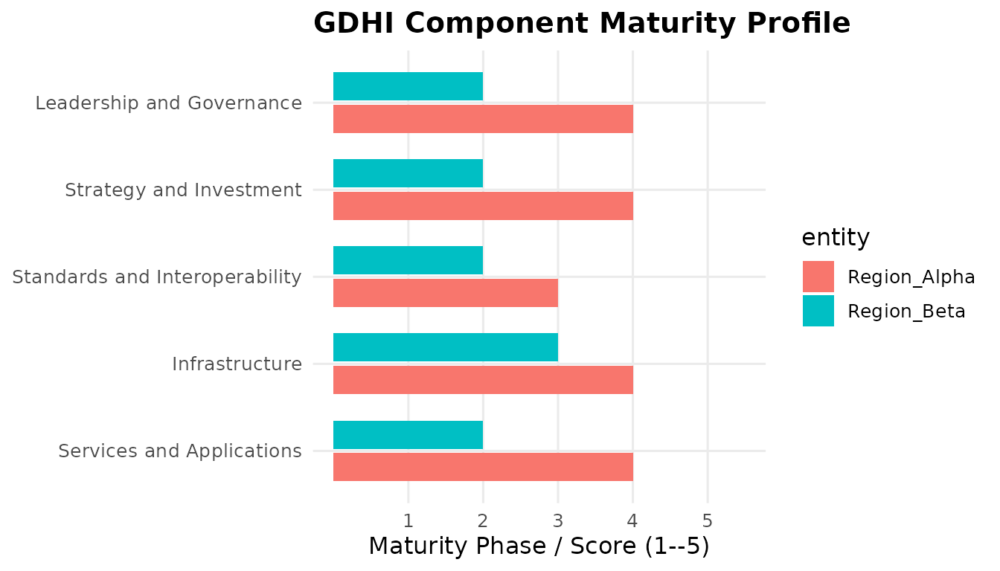

# Scoring Custom Digital Health Datasets with whodigitalhealthmonitor

``` r

library(whodigitalhealthmonitor)
```

## Overview

`whodigitalhealthmonitor` lets researchers, evaluators, and health
system teams import their own survey or assessment tables (such as CSV
or Excel files) and score digital health ecosystem maturity against the
Global Digital Health Index (GDHI) indicator structure.

## 1. Inspect the Indicator Dictionary

``` r

dict <- gdhi_indicator_dictionary()
head(dict, 10)
#> # A tibble: 10 × 6
#>    indicator_id parent_id is_subindicator component_number component_name       
#>    <chr>        <chr>     <lgl>                      <int> <chr>                
#>  1 IND_01       NA        FALSE                          1 Leadership and Gover…
#>  2 IND_02       NA        FALSE                          1 Leadership and Gover…
#>  3 IND_03       NA        FALSE                          2 Strategy and Investm…
#>  4 IND_04       NA        FALSE                          2 Strategy and Investm…
#>  5 IND_05       NA        FALSE                          3 Legislation, Policy,…
#>  6 IND_06       NA        FALSE                          3 Legislation, Policy,…
#>  7 IND_07       NA        FALSE                          3 Legislation, Policy,…
#>  8 IND_08       NA        FALSE                          3 Legislation, Policy,…
#>  9 IND_09       NA        FALSE                          4 Workforce            
#> 10 IND_09A      IND_09    TRUE                           4 Workforce            
#> # ℹ 1 more variable: indicator_title <chr>
```

## 2. Convert Raw WEF Network Readiness Scores (Indicator 15)

If your dataset contains raw WEF Network Readiness Index scores (`1.0`
to `7.0`) for Indicator 15, convert them to GDHI maturity phases (`1` to
`5`) first:

``` r

wef_to_phase15(c(2.8, 3.6, 4.5, 5.2, 6.0))
#> [1] 1 2 3 4 5
```

## 3. Score Your Own Dataset

Prepare or import a data frame or tibble with an entity identifier
column (such as `region`, `district`, or `country`) and numeric columns
(`1` to `5`) matching GDHI indicator IDs (such as `IND_01` through
`IND_19`):

``` r

user_data <- tibble::tibble(
  entity = c("Region_Alpha", "Region_Beta"),
  IND_01 = c(4, 2),
  IND_02 = c(3, 2),
  IND_03 = c(4, 2),
  IND_04 = c(3, 1),
  IND_13 = c(3, 2),
  IND_14 = c(2, 1),
  IND_15 = c(4, 3),
  IND_16 = c(3, 2),
  IND_17 = c(4, 2)
)

scores <- gdhi_score_maturity(user_data, id_col = entity)
scores
#> # A tibble: 10 × 8
#>    entity       component_number component_name      n_indicators component_mean
#>    <chr>                   <int> <chr>                      <int>          <dbl>
#>  1 Region_Alpha                1 Leadership and Gov…            2            3.5
#>  2 Region_Alpha                2 Strategy and Inves…            2            3.5
#>  3 Region_Alpha                5 Standards and Inte…            2            2.5
#>  4 Region_Alpha                6 Infrastructure                 2            3.5
#>  5 Region_Alpha                7 Services and Appli…            1            4  
#>  6 Region_Beta                 1 Leadership and Gov…            2            2  
#>  7 Region_Beta                 2 Strategy and Inves…            2            1.5
#>  8 Region_Beta                 5 Standards and Inte…            2            1.5
#>  9 Region_Beta                 6 Infrastructure                 2            2.5
#> 10 Region_Beta                 7 Services and Appli…            1            2  
#> # ℹ 3 more variables: component_phase <int>, overall_raw_mean <dbl>,
#> #   overall_score <int>
```

## 4. Visualize Component Maturity

``` r

gdhi_plot_components(scores, id_col = entity)
```


